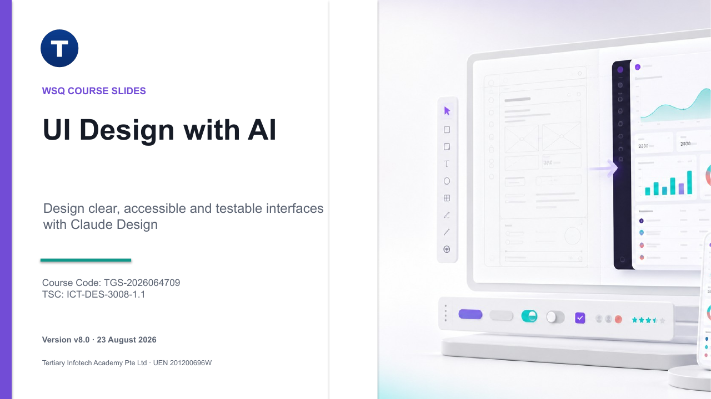

# Claude Design for UX/UI

A one-day, hands-on course on principle-led UI design with Claude Design, from research and information flow to design systems, prototypes, evaluation and handoff.

| Course detail | Information |
|---|---|
| Course code | `C744` |
| Programme | Non-WSQ |
| Duration | 1 day, 9:30 AM - 5:30 PM (7.5 instructional hours) |
| Delivery | Instructor-led, hands-on |
| Registration | [View course details and register](https://www.tertiarycourses.com.sg/claude-design-for-ux-ui.html) |

## About the course

Learners use Claude Design to turn evidence into interface decisions: they map user needs and information flows, build a design system and reusable components, produce an interactive responsive prototype, then evaluate, document and hand it off.

## Learning outcomes

1. Identify user needs, required functionality and information flows for an interface.
2. Develop reusable interface components and states with Claude Design.
3. Design, prototype and evaluate a responsive graphical user interface against defined metrics.
4. Document design decisions, manage revisions, export deliverables and craft user guidance.

## Topics covered

1. Requirements, research and information flow
2. Claude Design workflow and design systems
3. Components, states and interaction
4. Evaluation, documentation and handoff

## Public package contents

- [Slide deck v3.0 (PowerPoint)](courseware/Claude%20Design%20for%20UX-UI-v3.0.pptx) and [PDF](courseware/Claude%20Design%20for%20UX-UI-v3.0.pdf) - 139 slides, Claude house theme
- Lesson Plan: [DOCX](courseware/LP-Claude%20Design%20for%20UX-UI.docx) and [PDF](courseware/LP-Claude%20Design%20for%20UX-UI.pdf)
- Learner Guide: [DOCX](courseware/LG-Claude%20Design%20for%20UX-UI.docx) and [PDF](courseware/LG-Claude%20Design%20for%20UX-UI.pdf)
- Eight self-contained hands-on labs under [labs/](labs/README.md), each with a printable `Sample-Code.pdf`
- Working HTML/CSS/JavaScript examples for components, responsive booking and accessibility review

The slide deck is concept-led. Detailed procedures, prompts, code, evidence requirements and acceptance checks are kept in the Learner Guide and lab folders.

## Labs

1. Research Brief and Requirements
2. Information Flow and Principle Audit
3. Claude Design Project and Design System
4. Prompted Wireframes and Variants
5. Reusable Components and States
6. Interactive Responsive Prototype
7. Usability and Accessibility Evaluation
8. Documentation, Export and Handoff

Start with [labs/README.md](labs/README.md), then open the numbered lab folder. Each lab includes its own instructions, prompt, working files and printable code mirror.

## Course page

[Claude Design for UX/UI](https://www.tertiarycourses.com.sg/claude-design-for-ux-ui.html)

## Distribution boundary

This repository publishes the courseware (slides, Lesson Plan, Learner Guide, labs). Assessment material and source references are kept private and are not included.

## Provider

Tertiary Infotech Academy Pte Ltd (UEN 201200696W) - [www.tertiarycourses.com.sg](https://www.tertiarycourses.com.sg)
